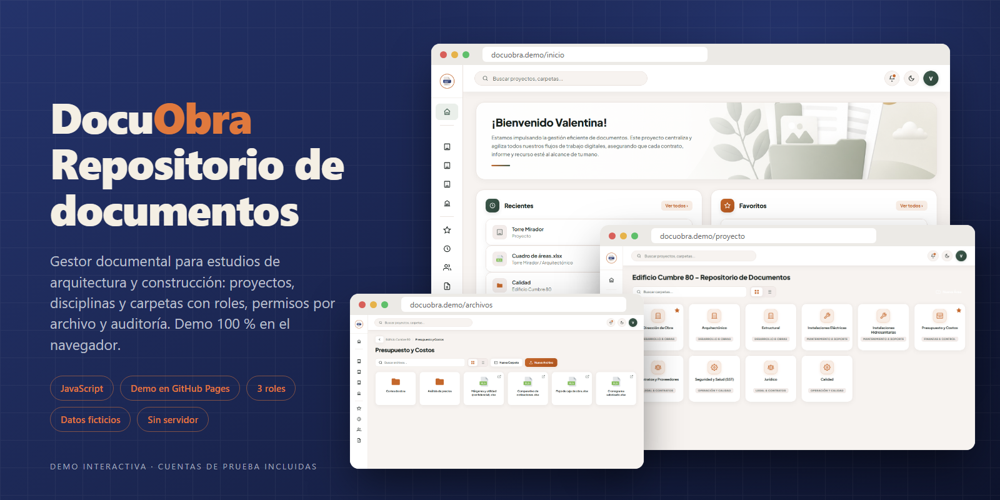
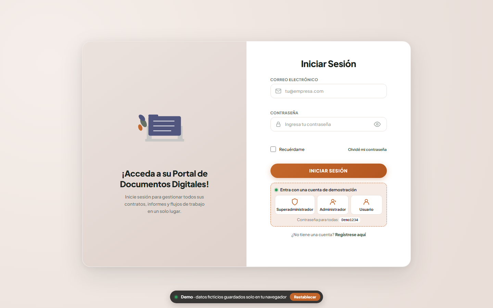
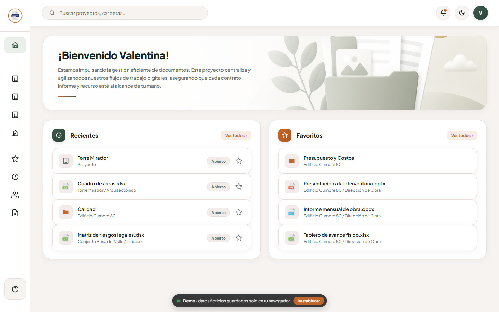
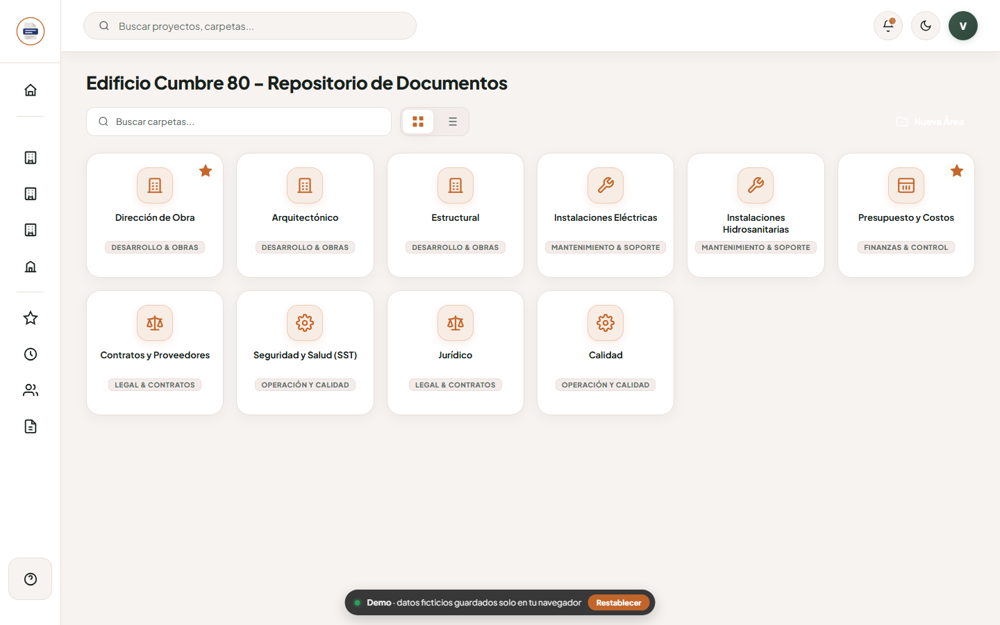
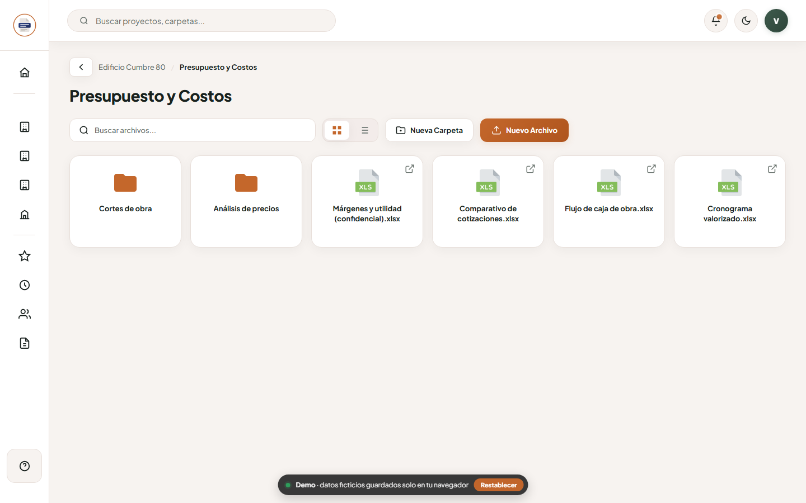
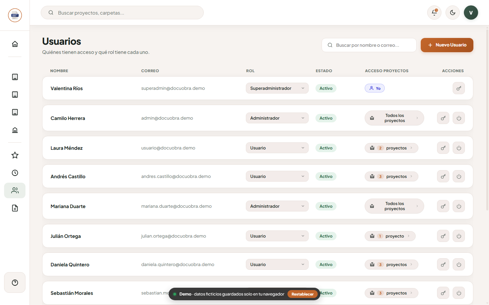
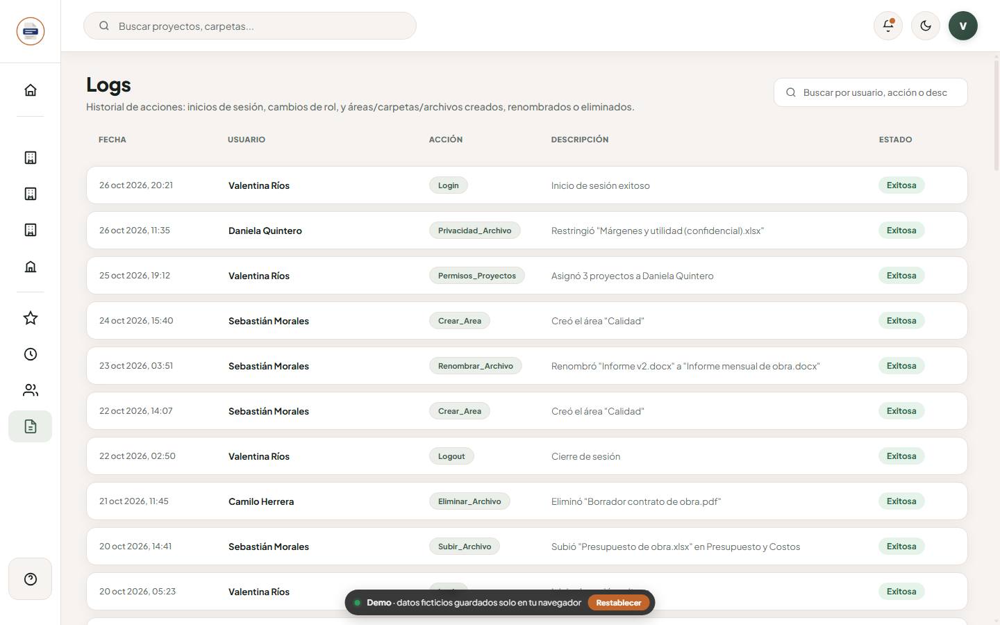

<div align="center">



# DocuObra · Repositorio de Documentos

**Gestor documental para estudios de arquitectura y construcción: proyectos, disciplinas, carpetas y archivos con roles, permisos por archivo y trazabilidad.**


-F7DF1E?style=flat-square&logo=javascript&logoColor=black)


</div>

---

## Sobre el proyecto

**DocuObra** centraliza la documentación de todos los proyectos de un estudio de arquitectura en un solo lugar. En vez de enviar planos por correo o tenerlos repartidos en carpetas personales, cada proyecto tiene sus **disciplinas** (arquitectónico, estructural, instalaciones, presupuesto, jurídico…) con subcarpetas, archivos y permisos propios.

Este repositorio contiene una **demo interactiva, solo frontend**: una aplicación de una sola página en JavaScript vanilla, con un servidor simulado dentro del navegador. No hay backend, base de datos ni conexión con ningún servicio externo.

> [!NOTE]
> Todos los datos son **ficticios**: nombres, correos, proyectos y documentos son inventados y no corresponden a personas, empresas ni archivos reales. Los cambios que hagas se guardan solo en tu navegador (`localStorage`).

---

## Pruébalo

### [cabrales16.github.io/docuobra](https://cabrales16.github.io/docuobra/)

En la pantalla de inicio de sesión hay **accesos rápidos** para entrar con cada rol:

| Rol | Correo | Contraseña | Qué puede hacer |
|---|---|---|---|
| Superadministrador | `superadmin@docuobra.demo` | `Demo1234` | Todo: usuarios, roles, proyectos asignados por usuario y registros |
| Administrador | `admin@docuobra.demo` | `Demo1234` | Gestiona disciplinas, carpetas, archivos y usuarios |
| Usuario | `usuario@docuobra.demo` | `Demo1234` | Consulta y sube documentos en sus 2 proyectos asignados |

El botón **Restablecer** de la insignia inferior devuelve la demo a su estado inicial.

<details>
<summary>Correr la demo en local</summary>

Es un sitio estático, así que basta con servir la carpeta:

```bash
git clone https://github.com/Cabrales16/docuobra.git
cd docuobra
npx serve .            # o: python -m http.server 8080
```

</details>

---

## Funcionalidades

| | |
|---|---|
| **Proyectos agrupados por estado** | Obras en ejecución, proyectos en diseño, proyectos entregados e institucional, en una barra lateral con buscador. |
| **Disciplinas y explorador de carpetas** | Disciplinas por proyecto, con subcarpetas anidadas, ruta de navegación, vista de tarjetas o de lista y búsqueda en vivo. |
| **Subida múltiple** | Arrastrar y soltar varios archivos o elegirlos desde un explorador de Drive simulado. |
| **Privacidad por archivo** | Para cada archivo: *Todos*, *Solo yo*, *Todos excepto…* o *Solo un grupo*, con grupos reutilizables. |
| **Vista previa** | Visor integrado en un panel lateral, sin salir de la app. |
| **Favoritos y recientes** | Atajos a carpetas y archivos, e historial de lo último que abriste o subiste. |
| **Búsqueda global** | Proyectos y carpetas desde la barra superior. |
| **Gestión de usuarios** | Aprobar registros, activar o desactivar, cambiar roles, restablecer contraseñas y asignar proyectos por usuario. |
| **Auditoría** | Inicios de sesión, cambios de rol y creación, renombre o eliminación de disciplinas, carpetas y archivos. |
| **Tema claro y oscuro** | Se guarda por usuario. |

---

## Capturas

| Inicio de sesión | Inicio |
|---|---|
|  |  |

| Disciplinas de un proyecto | Explorador de archivos |
|---|---|
|  |  |

| Usuarios y permisos | Auditoría |
|---|---|
|  |  |

---

## Estructura

```
index.html          Aplicación completa (interfaz y lógica)
demo/               Servidor simulado: datos ficticios, API en el navegador y estilos de la demo
assets/             Logotipos, ilustración y iconos de tipo de archivo
docs/screenshots/   Capturas y banner del README
```

---

## Transparencia

Este proyecto se desarrolló con asistencia de IA (Claude) en el código, los datos de ejemplo y la documentación. La revisión, las decisiones y las pruebas son mías.

---

<div align="center">

**Andrés Cabrales Baena** · Desarrollador de software · [andrescabralesbaena.com](https://andrescabralesbaena.com)

</div>
